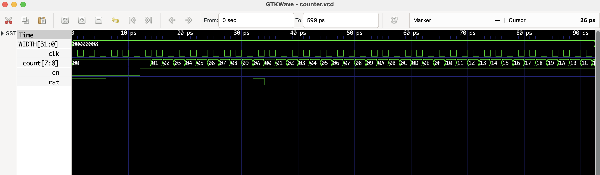
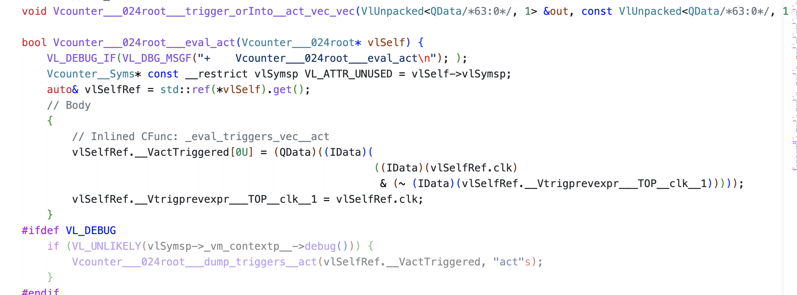
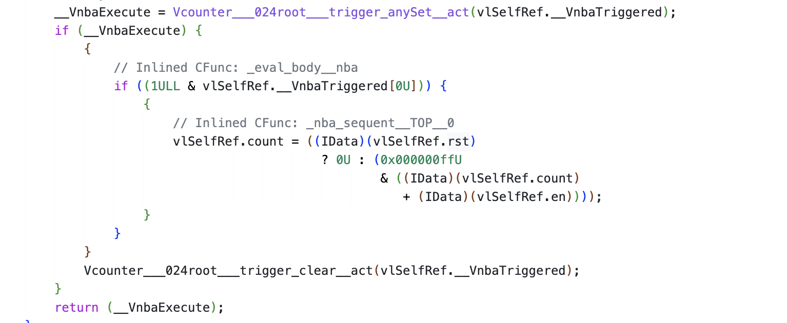
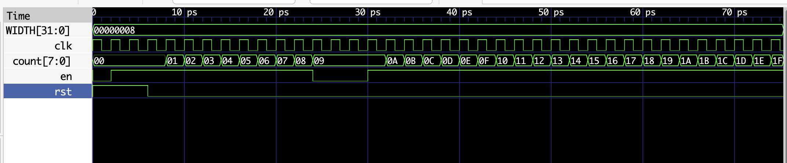
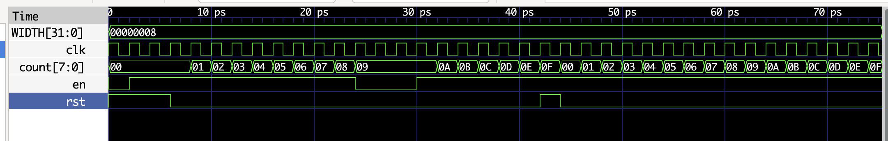
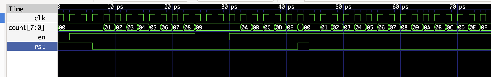

# Task 1: Simulating a Basic 8-bit Binary Counter

## Overview

The aim of this task was to implement and simulate a parameterised
8-bit binary counter using SystemVerilog, Verilator and a C++ testbench.

Verilator was used to translate the SystemVerilog design into a C++
simulation model. The compiled model generated a VCD waveform file,
which was examined using GTKWave.

---

## Counter design

The counter has three inputs and one output:

| Signal | Direction | Width | Description |
|---|---|---:|---|
| `clk` | Input | 1 bit | Clock signal |
| `rst` | Input | 1 bit | Synchronous reset |
| `en` | Input | 1 bit | Counter enable |
| `count` | Output | 8 bits | Current counter value |

The width of the counter is controlled by the parameter `WIDTH`:

```systemverilog
module counter #(
    parameter WIDTH = 8
)(
    input  logic             clk,
    input  logic             rst,
    input  logic             en,
    output logic [WIDTH-1:0] count
);
```

The sequential counter logic is:

```systemverilog
always_ff @(posedge clk)
    if (rst)
        count <= {WIDTH{1'b0}};
    else
        count <= count + {{WIDTH-1{1'b0}}, en};
```

The counter is updated only on the rising edge of `clk`.

When `rst` is high, the following expression clears the counter:

```systemverilog
{WIDTH{1'b0}}
```

The replication operator repeats `1'b0` a total of `WIDTH` times. When
`WIDTH=8`, the result is:

```systemverilog
8'b00000000
```

The increment value is produced by:

```systemverilog
{{WIDTH-1{1'b0}}, en}
```

For an 8-bit counter, this is equivalent to:

```systemverilog
{7'b0000000, en}
```

Therefore:

- when `en=0`, zero is added and the counter retains its value;
- when `en=1`, one is added and the counter increments.

The behaviour can be summarised as:

| `rst` | `en` | Next value of `count` |
|---:|---:|---|
| 1 | X | `0` |
| 0 | 0 | `count` |
| 0 | 1 | `count + 1` |

Because the reset is checked inside `always_ff @(posedge clk)`, it is a
**synchronous reset**. The counter is cleared only when a rising clock
edge occurs while `rst` is high.

---

## C++ testbench

The testbench includes the Verilated counter model and waveform tracing
support:

```cpp
#include "Vcounter.h"
#include "verilated.h"
#include "verilated_vcd_c.h"
```

The counter model is instantiated using:

```cpp
Vcounter* top = new Vcounter;
```

Waveform tracing is enabled and written to `counter.vcd`:

```cpp
Verilated::traceEverOn(true);

VerilatedVcdC* tfp = new VerilatedVcdC;

top->trace(tfp, 99);
tfp->open("counter.vcd");
```

The input signals are initially set to:

```cpp
top->clk = 1;
top->rst = 1;
top->en = 0;
```

A complete clock cycle is generated by toggling the clock twice:

```cpp
for (clk = 0; clk < 2; clk++) {
    tfp->dump(2*i + clk);
    top->clk = !top->clk;
    top->eval();
}
```

The call to:

```cpp
top->eval();
```

causes the Verilated hardware model to evaluate its current inputs and
update its internal state.

The original test stimulus is:

```cpp
top->rst = (i < 2) | (i == 15);
top->en = (i > 4);
```

This produces the following behaviour:

1. Reset is asserted during the first two simulation cycles.
2. The counter is initially disabled.
3. Enable becomes high after the first five cycles.
4. Reset is asserted again when `i == 15`.
5. The counter resumes after reset is released.

At the end of the simulation, the VCD file is closed:

```cpp
tfp->close();
```

---

## Building and running

Verilator translates the SystemVerilog module and combines it with the
C++ testbench:

```bash
verilator -Wall --cc --trace counter.sv --exe counter_tb.cpp
```

The generated C++ model is compiled using:

```bash
make -j -C obj_dir/ -f Vcounter.mk Vcounter
```

The simulation executable is then run using:

```bash
obj_dir/Vcounter
```

These commands are combined in [`doit.sh`](doit.sh):

```bash
#!/bin/bash

verilator -Wall --cc --trace counter.sv --exe counter_tb.cpp
make -j -C obj_dir/ -f Vcounter.mk Vcounter
obj_dir/Vcounter
```

The entire simulation can therefore be rebuilt and run with:

```bash
./doit.sh
```

Verilator automatically creates the `obj_dir` directory. Files inside
this directory are generated files and should not be edited manually.

---

## Simulation results

Running the simulation produces:

```text
counter.vcd
```

The waveform was opened in GTKWave, where the following signals were
examined:

- `clk`
- `rst`
- `en`
- `count[7:0]`



*Figure 1: GTKWave simulation result for the basic 8-bit counter.*

At the beginning of the simulation, `rst` is high and the counter is
cleared to `0x00`.

When reset is released, the counter initially remains at zero because
`en=0`. Once `en` becomes high, `count` increments on each rising clock
edge:

```text
00 → 01 → 02 → 03 → ...
```

When reset is asserted again, the counter returns to `0x00`. After reset
is released, counting resumes.

The waveform therefore confirms that:

- the counter responds only to rising clock edges;
- `rst` clears the counter;
- `en=0` causes the counter to hold its value;
- `en=1` causes the counter to increment.

---

## Verilator deep dive

Verilator generates a collection of C++ source and header files inside
`obj_dir`.

The generated public interface is stored in `Vcounter.h`. The
SystemVerilog ports are represented by C++ members corresponding to:

```text
clk
rst
en
count
```

### Rising-edge detection

The generated C++ implementation stores the previous value of `clk` and
compares it with the current value.



*Figure 2: C++ rising-edge detection generated from `posedge clk`.*

The important expression is equivalent to:

```cpp
current_clk & ~previous_clk
```

It evaluates to one only when:

```text
previous clk = 0
current clk  = 1
```

Therefore, it detects the transition:

```text
0 → 1
```

which corresponds to:

```systemverilog
posedge clk
```

After evaluating the trigger, Verilator saves the current clock value
for the next comparison.

### Counter update logic

The generated counter update is shown below.



*Figure 3: Generated reset, enable and count-update logic.*

The generated C++ statement is equivalent to:

```cpp
if (rst)
    count = 0;
else
    count = (count + en) & 0xff;
```

The conditional expression implements the synchronous reset. When
`rst=1`, the counter is assigned zero. Otherwise, `en` is added to the
current value.

The mask:

```cpp
0xff
```

is equal to:

```text
11111111
```

in binary. It ensures that only the lowest eight bits are retained.

Consequently, the counter wraps around after reaching its maximum value:

```text
FE → FF → 00 → 01
```

The function containing the counter update includes `nba` in its name.
This represents the **non-blocking assignment** used in the original
SystemVerilog code:

```systemverilog
count <= ...
```

---

## Challenge 1: Pause at 0x09

The first challenge was to modify the testbench so that the counter stops
for three clock cycles when it reaches `0x09`, and then resumes counting.

The original counter module was not changed. The challenge was
implemented entirely in the C++ testbench.

The complete implementation is stored in:

[Open the Challenge 1 source folder](../task1-challenge1/)

### Implementation

Two variables were added to the testbench:

```cpp
int pause_cycles = 0;
bool paused = false;
```

`pause_cycles` records how many paused cycles remain. The Boolean
variable `paused` ensures that the pause is triggered only once.

The counter value is checked using:

```cpp
if (!paused && top->count == 0x9) {
    pause_cycles = 3;
    paused = true;
}
```

When the counter first reaches `0x09`, the pause counter is set to three.

The enable signal is then controlled using:

```cpp
if (pause_cycles > 0) {
    top->en = 0;
    pause_cycles--;
} else {
    top->en = 1;
}
```

While `pause_cycles` is greater than zero, `en` is kept low and the
counter retains its value.

The `paused` variable is necessary because `count` remains equal to
`0x09` during the pause. Without this variable, the program would
repeatedly set `pause_cycles` back to three, causing the counter to
remain at `0x09` indefinitely.

### Result



*Figure 4: The counter pauses at `0x09` for three clock cycles before continuing.*

The waveform shows that:

1. The counter increments normally from `0x00` to `0x09`.
2. When `count=0x09`, `en` becomes low.
3. The count remains at `0x09` for three clock cycles.
4. `en` returns high.
5. The counter continues with `0x0A`, `0x0B` and subsequent values.

This result confirms that the pause was implemented successfully without
changing the SystemVerilog counter module.

---

## Challenge 2: Asynchronous reset

The original counter uses a synchronous reset:

```systemverilog
always_ff @(posedge clk)
```

A synchronous reset is only processed on a rising clock edge.

The second challenge was to change the counter to use an asynchronous
reset. The complete implementation is stored in:

[Open the Challenge 2 source folder](../task1-challenge2/)


### Implementation

The sensitivity list was changed from:

```systemverilog
always_ff @(posedge clk)
```

to:

```systemverilog
always_ff @(posedge clk or posedge rst)
```

The complete sequential logic became:

```systemverilog
always_ff @(posedge clk or posedge rst)
    if (rst)
        count <= {WIDTH{1'b0}};
    else
        count <= count + {{WIDTH-1{1'b0}}, en};
```

The addition of:

```systemverilog
or posedge rst
```

means that the block is evaluated whenever either:

- a rising clock edge occurs; or
- `rst` changes from zero to one.

A reset pulse was introduced during the simulation so that the
synchronous and asynchronous versions could be compared.

### Synchronous-reset result



*Figure 5: Behaviour of the counter with synchronous reset.*

In the synchronous version, asserting `rst` does not immediately clear
the counter. The counter is cleared at the next rising edge of `clk`.

The behaviour can be summarised as:

```text
rst asserted
      ↓
wait for rising clock edge
      ↓
count becomes zero
```

### Asynchronous-reset result



*Figure 6: Behaviour of the counter with asynchronous reset.*

In the asynchronous version, the counter is cleared as soon as `rst`
is asserted. It does not need to wait for a rising clock edge.

The behaviour is:

```text
rst asserted
      ↓
count immediately becomes zero
```

The remainder of the counting behaviour is unchanged. The difference
between the two implementations is visible only when reset is asserted
between clock edges.

This comparison demonstrates that synchronous and asynchronous resets
can produce similar overall waveforms, but differ in the exact time at
which the stored state is cleared.

---

## Conclusion

Task 1 demonstrated the complete workflow for describing, compiling and
simulating a sequential digital circuit.

An 8-bit binary counter was implemented using SystemVerilog and converted
into an executable C++ model using Verilator. A C++ testbench generated
the clock, reset and enable inputs, while GTKWave was used to verify the
resulting behaviour.

Inspecting the generated C++ code showed how Verilator represents rising
clock-edge detection, non-blocking assignments, reset behaviour and
8-bit overflow.

The first challenge demonstrated that more advanced stimulus behaviour
can be implemented in the C++ testbench without modifying the hardware
module. The second challenge demonstrated the behavioural difference
between synchronous and asynchronous reset.