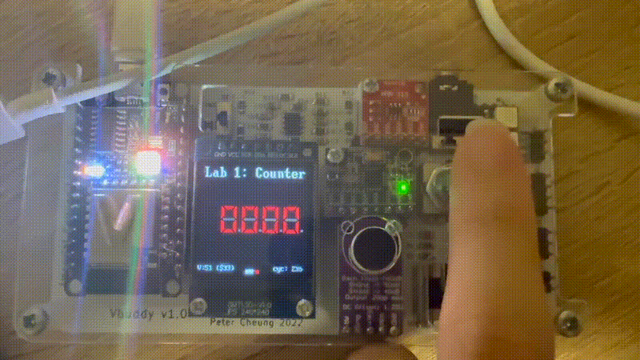
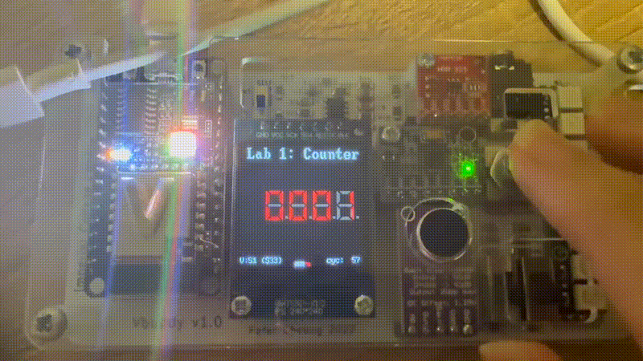

# Task 2: Connecting the Counter to Vbuddy

## Overview

The aim of Task 2 was to connect the Verilator counter simulation to the
Vbuddy development board.

In Task 1, the output of the counter was examined using GTKWave. In this
task, the simulated counter value was sent to Vbuddy and displayed using
its four-digit hexadecimal display.

The push button on the rotary encoder was also used to control the
counter through the `en` input.

---

## Vbuddy setup

Vbuddy communicates with the computer through a USB serial connection.

On macOS, the connected serial devices can be listed using:

```bash
ls /dev/tty.u*
```

A connected Vbuddy device appears with a name similar to:

```text
/dev/tty.usbserial-14120
```

The correct device path must be stored as the only line in:

```text
vbuddy.cfg
```

The device name is specific to the local computer and USB connection.
It may need to be updated if Vbuddy is connected to a different computer
or appears under a different serial-port name.

The Vbuddy implementation is included in the testbench using:

```cpp
#include "vbuddy.cpp"
```

After waveform tracing is configured, the connection to Vbuddy is opened:

```cpp
if (vbdOpen() != 1) return -1;
vbdHeader("Lab 1: Counter");
```

The function:

```cpp
vbdOpen()
```

reads the serial-port path from `vbuddy.cfg` and attempts to connect to
the board. If the connection fails, the testbench returns `-1` and stops.

The function:

```cpp
vbdHeader("Lab 1: Counter");
```

displays the title `Lab 1: Counter` at the top of the Vbuddy screen.

---

## Testbench modifications

The SystemVerilog counter used in this task is the same basic counter
implemented in Task 1:

```systemverilog
always_ff @(posedge clk)
    if (rst)
        count <= {WIDTH{1'b0}};
    else
        count <= count + {{WIDTH-1{1'b0}}, en};
```

The counter:

- resets to zero when `rst=1`;
- increments when `en=1`;
- retains its current value when `en=0`.

The main change in Task 2 was made to the C++ testbench.

The simulation continues to generate the clock using:

```cpp
for (clk = 0; clk < 2; clk++) {
    tfp->dump(2*i + clk);
    top->clk = !top->clk;
    top->eval();
}
```

After each complete simulation cycle, the current value of `count` is
sent to Vbuddy.

---

## Displaying the counter value

The four hexadecimal display positions are updated using:

```cpp
vbdHex(4, (int(top->count) >> 16) & 0xF);
vbdHex(3, (int(top->count) >> 8) & 0xF);
vbdHex(2, (int(top->count) >> 4) & 0xF);
vbdHex(1, int(top->count) & 0xF);
vbdCycle(i + 1);
```

The function:

```cpp
vbdHex(position, value);
```

writes one hexadecimal digit to a specified display position.

The expression:

```cpp
int(top->count) & 0xF
```

extracts the lowest four bits of `count`. These bits form the rightmost
hexadecimal digit.

The expression:

```cpp
(int(top->count) >> 4) & 0xF
```

shifts the counter value right by four bits and extracts the next
hexadecimal digit.

For example, if:

```text
count = 8'b10101100
```

then:

```text
count = 0xAC
```

and Vbuddy displays:

```text
00AC
```

Since the counter is only eight bits wide, the first two display
positions remain zero.

The call:

```cpp
vbdCycle(i + 1);
```

completes the Vbuddy communication for the current simulation cycle and
updates the displayed information.

---

## Controlling the counter

The Vbuddy rotary encoder contains a push-button switch. Its internal
flag is read using:

```cpp
top->en = vbdFlag();
```

In the default toggle mode, pressing the button changes the flag state:

```text
0 → 1 → 0 → 1 → ...
```

Therefore:

- when the flag is `1`, `en=1` and the counter increments;
- when the flag is `0`, `en=0` and the counter holds its value.

This allows the counter to be started and stopped using the physical
button on Vbuddy.

The reset stimulus remains:

```cpp
top->rst = (i < 2) | (i == 15);
```

This resets the counter at the beginning of the simulation and once
again when `i == 15`.

When the simulation ends, the Vbuddy and VCD connections are closed:

```cpp
vbdClose();
tfp->close();
```

Calling `vbdClose()` ensures that the serial connection is released
correctly.

---

## Building and running

The design is translated using Verilator:

```bash
verilator -Wall --cc --trace counter.sv --exe counter_tb.cpp
```

The generated model is compiled using:

```bash
make -j -C obj_dir/ -f Vcounter.mk Vcounter
```

The simulation is then run using:

```bash
obj_dir/Vcounter
```

These commands are included in [`doit.sh`](doit.sh), so the complete
process can be performed using:

```bash
./doit.sh
```

Before running the simulation:

1. Vbuddy must be connected by USB.
2. The serial-port path in `vbuddy.cfg` must be correct.
3. The terminal must be in the `task2` directory.

---

## Result

The following demonstration shows the simulated counter operating on
Vbuddy.



*Figure 1: Starting and stopping the simulated counter using the Vbuddy push button.*

The result confirmed that:

1. The Verilator simulation connected successfully to Vbuddy.
2. The counter value was shown on the hexadecimal display.
3. Pressing the rotary-encoder button changed the flag state.
4. The counter incremented while the flag was high.
5. The counter retained its value while the flag was low.
6. Counting resumed from the retained value when the button was pressed
   again.

This demonstrated that Vbuddy could be used as a physical input and
output interface for a simulated SystemVerilog design.

---

## Challenge: Up and down counter

The challenge was to modify the counter so that `en` controls the
direction of counting instead of simply enabling or disabling the
counter.

The required behaviour was:

| `rst` | `en` | Operation |
|---:|---:|---|
| 1 | X | Reset to zero |
| 0 | 1 | Count upwards |
| 0 | 0 | Count downwards |

The challenge implementation is stored separately:

[Open the Task 2 Challenge source folder](../task2-challenge/)

Key files:

- [`counter.sv`](../task2-challenge/counter.sv)
- [`counter_tb.cpp`](../task2-challenge/counter_tb.cpp)
- [`doit.sh`](../task2-challenge/doit.sh)

### SystemVerilog modification

The original counter logic was:

```systemverilog
always_ff @(posedge clk)
    if (rst)
        count <= {WIDTH{1'b0}};
    else
        count <= count + {{WIDTH-1{1'b0}}, en};
```

In the original version, `en=0` caused the counter to retain its value.

For the challenge, the logic was changed to:

```systemverilog
always_ff @(posedge clk) begin
    if (rst)
        count <= {WIDTH{1'b0}};
    else if (en)
        count <= count + 1'b1;
    else
        count <= count - 1'b1;
end
```

The new behaviour is:

- `en=1`: increment by one;
- `en=0`: decrement by one.

The testbench continues to obtain `en` from Vbuddy:

```cpp
top->en = vbdFlag();
```

Because `vbdFlag()` operates in toggle mode, pressing the button switches
between upward and downward counting.

### Overflow and underflow

The counter is eight bits wide, so its valid range is:

```text
0x00 to 0xFF
```

When counting upwards from `0xFF`, the counter wraps to `0x00`:

```text
FE → FF → 00 → 01
```

When counting downwards from `0x00`, the counter wraps to `0xFF`:

```text
01 → 00 → FF → FE
```

This wrapping behaviour occurs naturally because only the lowest eight
bits are retained.

### Challenge result



*Figure 2: Changing the counting direction using the Vbuddy push button.*

The demonstration shows that pressing the rotary-encoder button changes
the direction of counting. When the flag is high, the displayed value
increases. When the flag is low, the displayed value decreases.

The challenge confirmed that one physical Vbuddy input could be used to
select between two different hardware operations.

---

## Conclusion

Task 2 demonstrated how a Verilator simulation can interact with a
physical Vbuddy board.

The counter value was transmitted to Vbuddy and displayed in hexadecimal
form. The rotary-encoder button was used to control the counter through
the `vbdFlag()` function.

The challenge extended the original counter so that the flag selected
the counting direction. This required a modification to the
SystemVerilog sequential logic while leaving the Vbuddy testbench
interface unchanged.

The task provided experience in connecting a simulated hardware design
to physical input and output devices.