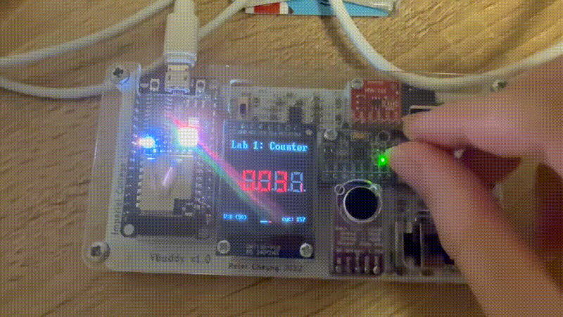
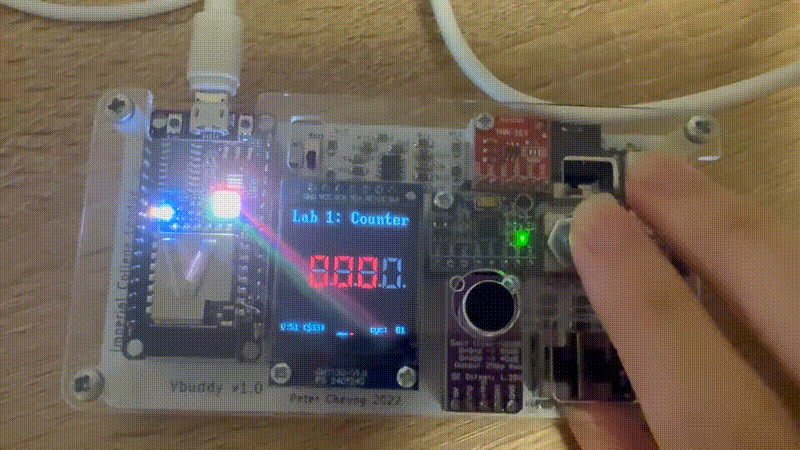

# Task 3: Vbuddy Parameter and One-Shot Mode

## Overview

The aim of Task 3 was to investigate two additional Vbuddy input
features:

- the rotary-encoder parameter value;
- the push-button flag in one-shot mode.

The first part used the rotary encoder to select a value that could be
loaded into the counter. The second part used the one-shot button signal
to increment the counter by exactly one step for each button press.

The original instructions are available in the
[official Lab 1 repository](https://github.com/ELEC50010-IAC/Lab1-Counter).

The loadable-counter implementation is stored in the `task3` folder:

- [`counter.sv`](counter.sv)
- [`counter_tb.cpp`](counter_tb.cpp)
- [`vbuddy.cpp`](vbuddy.cpp)
- [`doit.sh`](doit.sh)

The single-step implementation is stored separately so that the
loadable-counter version remains unchanged:

[Open the single-step implementation](../task3-step/)

Key single-step files:

- [`counter.sv`](../task3-step/counter.sv)
- [`counter_tb.cpp`](../task3-step/counter_tb.cpp)
- [`doit.sh`](../task3-step/doit.sh)

---

## Vbuddy parameter input

Turning the Vbuddy rotary encoder changes an internal parameter value.

This value is displayed near the bottom of the Vbuddy screen in both
decimal and hexadecimal form. The C++ testbench reads it using:

```cpp
vbdValue()
```

In the testbench, the selected parameter value is connected to the
counter input `v`:

```cpp
top->v = vbdValue();
```

The counter input is declared as:

```systemverilog
input logic [WIDTH-1:0] v
```

Since `WIDTH=8`, the counter stores an 8-bit value in the range:

```text
0x00 to 0xFF
```

The rotary encoder changes the value prepared for loading, but turning
the encoder alone does not immediately modify `count`. The value is
loaded only when the load signal `ld` is asserted.

---

## One-shot flag mode

In Task 2, `vbdFlag()` operated in its default toggle mode:

```text
button press → flag changes state
```

This allowed the button to switch continuously between two states.

Task 3 instead uses one-shot mode:

```cpp
vbdSetMode(1);
```

This call is made after opening the Vbuddy connection:

```cpp
if (vbdOpen() != 1) return -1;

vbdHeader("Lab 1: Counter");
vbdSetMode(1);
```

In one-shot mode, pressing the button sets the flag to one. When the
testbench reads the flag using:

```cpp
vbdFlag()
```

the value is returned once and then automatically reset to zero.

The resulting behaviour is:

```text
button pressed
      ↓
flag becomes 1
      ↓
vbdFlag() returns 1 once
      ↓
flag automatically returns to 0
```

The one-shot flag is connected to the counter's `ld` input:

```cpp
top->ld = vbdFlag();
```

It is important that `vbdFlag()` is read only once during each simulation
cycle. Reading it more than once could consume the one-shot event before
the required signal uses it.

---

## Part 1: Loadable counter

The first part of Task 3 implemented a counter that could load a value
from Vbuddy.

### Interface

The counter interface was changed from the Task 2 enable-controlled
counter to:

```systemverilog
module counter #(
    parameter WIDTH = 8
)(
    input  logic             clk,
    input  logic             rst,
    input  logic             ld,
    input  logic [WIDTH-1:0] v,
    output logic [WIDTH-1:0] count
);
```

The new signals are:

| Signal | Direction | Width | Description |
|---|---|---:|---|
| `ld` | Input | 1 bit | Load control |
| `v` | Input | 8 bits | Value to load |
| `count` | Output | 8 bits | Current count |

### Counter logic

The sequential logic is:

```systemverilog
always_ff @(posedge clk)
    if (rst)
        count <= {WIDTH{1'b0}};
    else
        count <= ld
                 ? v
                 : count + {{WIDTH-1{1'b0}}, 1'b1};
```

The conditional operator has the form:

```systemverilog
condition ? value_if_true : value_if_false
```

Therefore:

```systemverilog
ld ? v : count + 1
```

is equivalent to:

```systemverilog
if (ld)
    count <= v;
else
    count <= count + 1;
```

The complete behaviour is:

| `rst` | `ld` | Operation |
|---:|---:|---|
| 1 | X | Reset `count` to zero |
| 0 | 1 | Load `v` into `count` |
| 0 | 0 | Increment `count` |

### Testbench inputs

The new counter inputs are initialised using:

```cpp
top->clk = 1;
top->rst = 1;
top->ld = 0;
top->v = 0;
```

During each simulation cycle, the testbench reads both Vbuddy inputs:

```cpp
top->rst = (i < 2);
top->v = vbdValue();
top->ld = vbdFlag();
```

The rotary encoder determines `v`, while the push button generates the
one-shot `ld` signal.

### Expected operation

Suppose the rotary encoder is set to:

```text
40 decimal = 0x28
```

Pressing the button generates `ld=1` for one cycle. At the next active
clock edge, the counter loads:

```text
count = 0x28
```

Since `ld` then automatically returns to zero, the counter continues:

```text
28 → 29 → 2A → 2B → ...
```

If toggle mode were used instead of one-shot mode, `ld` could remain
high. The counter would repeatedly load the same value and appear to be
stuck. Calling `vbdSetMode(1)` prevents this behaviour.

---

## Building and running

The loadable-counter design is translated using:

```bash
verilator -Wall --cc --trace counter.sv --exe counter_tb.cpp
```

The generated model is compiled using:

```bash
make -j -C obj_dir/ -f Vcounter.mk Vcounter
```

The simulation is run using:

```bash
obj_dir/Vcounter
```

These commands are combined in [`doit.sh`](doit.sh), so the complete
process can be started with:

```bash
./doit.sh
```

Before running the design:

1. Vbuddy must be connected.
2. `vbuddy.cfg` must contain the correct serial-port path.
3. The terminal must be in the `task3` folder.

---

## Loadable-counter result

The following demonstration shows the counter loading a value selected
using the rotary encoder.



*Figure 1: Loading the Vbuddy parameter value into the counter.*

The demonstration confirms that:

1. Turning the rotary encoder changes the Vbuddy parameter.
2. The counter continues to increment while `ld=0`.
3. Pressing the button produces a one-shot load event.
4. The selected value is loaded into `count`.
5. The counter continues incrementing from the loaded value.

The result shows that the Vbuddy parameter and flag can be used together
to provide both data and control inputs to a SystemVerilog design.

---

## Part 2: Single-step counter

The second part of Task 3 modified the design so that the counter
increments only when the Vbuddy button is pressed.

The implementation is stored in:

[Open the single-step source folder](../task3-step/)

The same `ld` input is reused as a one-cycle increment signal.

### Modified counter logic

The loadable-counter logic was:

```systemverilog
count <= ld
         ? v
         : count + {{WIDTH-1{1'b0}}, 1'b1};
```

For single-step operation, it was changed to:

```systemverilog
count <= ld
         ? count + {{WIDTH-1{1'b0}}, 1'b1}
         : count;
```

This is equivalent to:

```systemverilog
if (ld)
    count <= count + 1;
else
    count <= count;
```

The complete behaviour becomes:

| `rst` | `ld` | Operation |
|---:|---:|---|
| 1 | X | Reset to zero |
| 0 | 1 | Increment by one |
| 0 | 0 | Retain the current value |

The one-shot flag remains connected using:

```cpp
top->ld = vbdFlag();
```

The testbench also retains:

```cpp
vbdSetMode(1);
```

Therefore, every physical button press produces only one increment
event.

The input `v` remains in the counter interface and testbench, but it is
not used by the single-step counter logic. It was retained so that the
single-step version required only a small change from the first part of
Task 3.

A future cleanup could remove `v` from both `counter.sv` and
`counter_tb.cpp`, but leaving it present does not affect the behaviour.

---

## Single-step result

The following demonstration shows the one-shot single-step operation.



*Figure 2: Incrementing the counter once for each Vbuddy button press.*

The result confirms that:

1. The counter remains unchanged while the button is not pressed.
2. Each button press generates one `ld` pulse.
3. Each `ld` pulse increments the counter by exactly one.
4. Holding the counter between presses demonstrates that the flag is
   operating in one-shot mode rather than toggle mode.

The expected sequence is:

```text
initial value: 00
first press:   01
second press:  02
third press:   03
```

---

## Comparison

The two parts of Task 3 use the same physical inputs but assign different
meanings to them.

| Feature | Loadable counter | Single-step counter |
|---|---|---|
| Rotary parameter `v` | Value to load | Not used |
| One-shot flag `ld` | Load control | Increment control |
| Behaviour when `ld=0` | Count continuously | Hold current value |
| Behaviour when `ld=1` | Load `v` | Increment by one |

For the loadable counter:

```systemverilog
ld ? v : count + 1
```

For the single-step counter:

```systemverilog
ld ? count + 1 : count
```

This demonstrates that the same external input can perform different
functions depending on the SystemVerilog logic connected to it.

---

## Conclusion

Task 3 demonstrated how Vbuddy can provide both a parameter value and a
one-shot control signal to a Verilator simulation.

In the first part, the rotary encoder selected an 8-bit value and the
button loaded that value into the counter. After loading, the counter
continued to increment normally.

In the second part, the counter was modified to retain its value until a
one-shot button event occurred. Each button press then incremented the
counter by exactly one.

This task demonstrated the difference between toggle and one-shot
control signals and showed how external physical inputs can control the
state of a simulated sequential circuit.