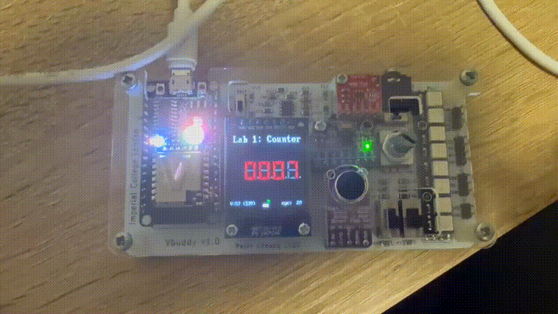

# Task 4 — Binary-to-BCD Counter

## Overview

In the previous tasks, the output of the counter was displayed directly as a binary or hexadecimal value. In this task, a binary-to-BCD converter is added so that the counter value can be displayed as separate decimal digits on Vbuddy.

The complete design contains three main parts:

1. The `counter` module generates an 8-bit binary count.
2. The `bin2bcd` module converts the binary count into Binary-Coded Decimal.
3. The `top` module connects the counter and converter together.

The source files used in this task are:

- `counter.sv` — the original parameterised counter
- `bin2bcd.sv` — the binary-to-BCD converter
- `top.sv` — the top-level module
- `top_tb.cpp` — the C++ testbench
- `doit.sh` — the build and simulation script

---

## Design Structure

The complete system can be represented as:

```text
        clk
        rst
        en
         │
         ▼
┌─────────────────┐
│     counter     │
│                 │
│  Binary counter │
└────────┬────────┘
         │
         │ count[7:0]
         ▼
┌─────────────────┐
│     bin2bcd     │
│                 │
│ Binary-to-BCD   │
│   conversion    │
└────────┬────────┘
         │
         │ bcd[11:0]
         ▼
     Vbuddy display
```

The signal `count` is an internal connection between the two modules. It is not directly exposed as an output of the top-level design.

---

## Binary and BCD Representation

Binary-Coded Decimal, or BCD, stores every decimal digit using a separate four-bit binary value.

For example, decimal `37` is represented differently in ordinary binary and BCD.

### Ordinary binary

```text
37₁₀ = 0010 0101₂
```

### Binary-Coded Decimal

The two decimal digits are encoded separately:

```text
3 → 0011
7 → 0111
```

Therefore:

```text
37₁₀ = 0000 0011 0111BCD
```

The 12-bit BCD output is divided into three four-bit digits:

| Output bits | Decimal digit |
|---|---|
| `bcd[11:8]` | Hundreds |
| `bcd[7:4]` | Tens |
| `bcd[3:0]` | Units |

For example:

```text
bcd = 0000 0011 0111
          │    │    │
          0    3    7
```

This represents the decimal value `037`.

For the maximum value of an 8-bit counter:

```text
1111 1111₂ = 255₁₀
```

the BCD output is:

```text
0010 0101 0101BCD
  2    5    5
```

---

## Binary-to-BCD Conversion

The `bin2bcd` module uses the **Double Dabble**, also known as the **shift-and-add-3**, algorithm.

A description of the conversion method is provided here:

[Binary-to-BCD conversion algorithm](<binary to BCD conversion algorithm.pdf>)

The main section of the converter is:

```systemverilog
always_comb begin
    result = 20'b0;
    result[7:0] = x;

    for (i = 0; i < 8; i = i + 1) begin
        if (result[11:8] >= 5)
            result[11:8] = result[11:8] + 3;

        if (result[15:12] >= 5)
            result[15:12] = result[15:12] + 3;

        result = result << 1;
    end

    BCD = result[19:8];
end
```

The algorithm operates as follows:

1. Store the 8-bit binary input in the least significant part of `result`.
2. Check each existing BCD digit before shifting.
3. If a BCD digit is greater than or equal to five, add three to it.
4. Shift the complete value left by one bit.
5. Repeat the process once for every input bit.
6. Extract the final three BCD digits from `result[19:8]`.

The converter uses `always_comb`, meaning that it is a combinational circuit. Its output changes whenever the binary input changes, without waiting for a clock edge.

---

## Top-Level Module

The `top` module connects the counter output to the binary-to-BCD converter.

```systemverilog
module top #(
    parameter WIDTH = 8
)(
    input  logic             clk,
    input  logic             rst,
    input  logic             en,
    input  logic [WIDTH-1:0] v,
    output logic [11:0]      bcd
);

logic [WIDTH-1:0] count;

counter myCounter (
    .clk   (clk),
    .rst   (rst),
    .en    (en),
    .count (count)
);

bin2bcd myDecoder (
    .x   (count),
    .BCD (bcd)
);

endmodule
```

The `counter` module receives the clock, reset and enable signals. Its output is stored in the internal signal `count`.

The statement

```systemverilog
logic [WIDTH-1:0] count;
```

creates the internal connection between the two modules.

The converter then receives this value through:

```systemverilog
.x(count)
```

and produces the 12-bit BCD output through:

```systemverilog
.BCD(bcd)
```

The input `v` is included in the supplied top-level interface but is not used by the current counter-to-BCD design. In the testbench, it is therefore held at zero.

---

## Testbench

Because `top.sv` is now the top-level SystemVerilog module, the testbench uses the Verilator-generated `Vtop` class:

```cpp
#include "Vtop.h"
```

The design is instantiated using:

```cpp
Vtop *top = new Vtop;
```

The initial input values are:

```cpp
top->clk = 1;
top->rst = 1;
top->en = 0;
top->v = 0;
```

The BCD output is divided into its individual decimal digits and displayed using four Vbuddy hexadecimal displays:

```cpp
vbdHex(4, 0);
vbdHex(3, (int(top->bcd) >> 8) & 0xF);
vbdHex(2, (int(top->bcd) >> 4) & 0xF);
vbdHex(1, int(top->bcd) & 0xF);
```

Each expression selects one four-bit BCD digit:

```cpp
(int(top->bcd) >> 8) & 0xF
```

extracts the hundreds digit,

```cpp
(int(top->bcd) >> 4) & 0xF
```

extracts the tens digit, and

```cpp
int(top->bcd) & 0xF
```

extracts the units digit.

The fourth display is fixed at zero because an 8-bit input can only reach decimal `255`.

The Vbuddy flag controls the enable signal:

```cpp
top->en = vbdFlag();
```

When the flag is active, the counter increments. When the flag is inactive, the counter holds its current value.

The reset stimulus is:

```cpp
top->rst = (i < 2) | (i == 15);
```

This resets the counter at the beginning of the simulation and resets it once again when `i` reaches 15.

---

## Building and Running

The Verilator command must specify `top` as the top-level module and include all three SystemVerilog source files:

```bash
verilator -Wall --cc --trace \
    --top-module top \
    top.sv counter.sv bin2bcd.sv \
    --exe top_tb.cpp
```

Verilator generates the `Vtop` simulation model. It is then compiled using:

```bash
make -j -C obj_dir/ -f Vtop.mk Vtop
```

Finally, the simulation is executed using:

```bash
obj_dir/Vtop
```

All three steps are included in `doit.sh`, so the complete design can be built and executed using:

```bash
./doit.sh
```

---

## Results

The following animation shows the counter value being converted into BCD and displayed on Vbuddy:



The digits increase in decimal order:

```text
0000
0001
0002
...
0009
0010
0011
...
0099
0100
...
0255
```

This is different from displaying an ordinary binary value as hexadecimal. For example, decimal `10` is binary `00001010`, which would normally appear as hexadecimal `0A`. After BCD conversion, it is represented by two separate decimal digits and displayed as `0010`.

The reset signal returns the display to:

```text
0000
```

The enable signal controls whether the displayed value increases or remains unchanged.

---

## Conclusion

In this task, the original counter was integrated with a binary-to-BCD converter using a new top-level SystemVerilog module.

The counter produces an 8-bit binary value, while the combinational `bin2bcd` module converts it into three BCD digits. The testbench separates these digits and sends them to the Vbuddy display.

This task demonstrates:

- how multiple SystemVerilog modules are connected;
- how an internal signal transfers data between modules;
- the difference between binary and BCD representation;
- how the Double Dabble algorithm converts binary values into decimal digits;
- how a new top-level module changes the corresponding Verilator C++ model; and
- how Vbuddy can be used to display the result of a hardware simulation.