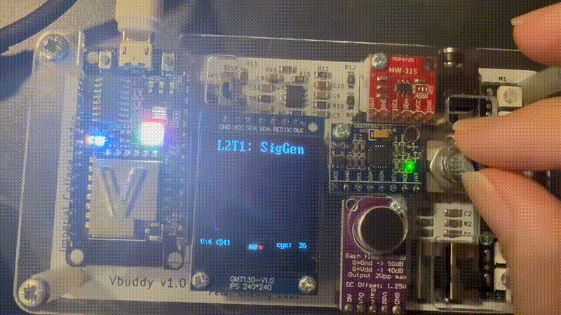

# Task 1 — ROM-Based Waveform Generator

## Contents

- [Overview](#overview)
- [Design Structure](#design-structure)
- [Generating the Waveform Data](#generating-the-waveform-data)
- [ROM Implementation](#rom-implementation)
- [Address Counter](#address-counter)
- [Top-Level Sine Generator](#top-level-sine-generator)
- [C++ Testbench](#c-testbench)
- [Building and Running](#building-and-running)
- [Basic Waveform Generation](#basic-waveform-generation)
- [Challenge — Variable-Frequency Generation](#challenge--variable-frequency-generation)
- [Results](#results)
- [Observations](#observations)
- [Conclusion](#conclusion)

---

## Overview

The purpose of Task 1 was to generate a periodic waveform using a counter and a read-only memory.

One complete waveform cycle was represented using 256 discrete samples. These samples were generated using Python, stored in a hexadecimal memory file and loaded into a SystemVerilog ROM.

An 8-bit counter generated the ROM address. As the address increased, the waveform samples were read sequentially and sent to Vbuddy for plotting.

The Task 1 Challenge extended the design by connecting the Vbuddy rotary encoder to the counter increment. This allowed the waveform frequency to be changed while the simulation was running.

The original instructions are available in the [official Lab 2 repository](https://github.com/ELEC50010-IAC/Lab2-SigGen).

---

## Design Structure

The complete waveform generator consists of a counter and a ROM:

```text
                 incr
                   │
                   ▼
             ┌───────────┐
 clk ───────►│           │
 rst ───────►│  Counter  │
 en  ───────►│           │
             └─────┬─────┘
                   │
                   │ address[7:0]
                   ▼
             ┌───────────┐
 clk ───────►│           │
             │    ROM    │
             │ 256 × 8   │
             └─────┬─────┘
                   │
                   │ dout[7:0]
                   ▼
              Vbuddy plot
```

The counter determines which waveform sample is read from the ROM.

The main files used in this task are:

- [`sinegen.py`](sinegen.py) — generates the waveform samples;
- [`sinerom.mem`](sinerom.mem) — stores the samples in hexadecimal form;
- [`counter.sv`](counter.sv) — generates the ROM address;
- [`rom.sv`](rom.sv) — stores and outputs the waveform samples;
- [`sinegen.sv`](sinegen.sv) — connects the counter and ROM;
- [`sinegen_tb.cpp`](sinegen_tb.cpp) — controls the simulation and Vbuddy;
- [`doit.sh`](doit.sh) — builds and runs the design.

---

## Generating the Waveform Data

The file `sinegen.py` generates 256 samples using:

```python
v = int(math.cos(2*3.1416*i/256)*127+127)
```

This implements approximately:

\[
v[i]=127\cos\left(\frac{2\pi i}{256}\right)+127
\]

where:

- \(i\) is the sample number from 0 to 255;
- the cosine function produces one complete waveform cycle;
- multiplication by 127 scales the amplitude;
- addition of 127 shifts the waveform into the unsigned 8-bit range.

Without the vertical offset, the cosine values would contain negative numbers. Adding 127 changes the approximate range from:

```text
-127 to +127
```

into:

```text
0 to 254
```

This makes the samples suitable for an unsigned 8-bit ROM.

Although the module is named `sinegen`, the supplied Python program uses `cos()`. A cosine wave has the same shape and frequency as a sine wave but differs by a phase shift of \(90^\circ\).

### Memory-file format

The generated values are written into `sinerom.mem` as hexadecimal numbers:

```text
FE FD FD FD FD FD FC FC FB FA ...
```

Example conversions include:

```text
FE₁₆ = 254₁₀
7F₁₆ = 127₁₀
00₁₆ = 0₁₀
```

The 256 values describe one complete waveform period:

```text
maximum → midpoint → minimum → midpoint → maximum
```

The memory file can be regenerated using:

```bash
python3 sinegen.py
```

---

## ROM Implementation

The ROM is parameterised by address and data width:

```systemverilog
module rom #(
    parameter ADDRESS_WIDTH = 8,
              DATA_WIDTH = 8
)(
    input  logic                     clk,
    input  logic [ADDRESS_WIDTH-1:0] addr,
    output logic [DATA_WIDTH-1:0]    dout
);
```

With an address width of 8 bits, the number of memory locations is:

\[
2^8=256
\]

Each location contains an 8-bit waveform sample. The memory array is declared using:

```systemverilog
logic [DATA_WIDTH-1:0] rom_array [2**ADDRESS_WIDTH-1:0];
```

With the default parameters, this is equivalent to:

```systemverilog
logic [7:0] rom_array [255:0];
```

The two ranges represent different properties:

```text
logic [7:0] rom_array [255:0]
       │                 │
       │                 └── 256 memory locations
       └──────────────────── each location contains 8 bits
```

### Loading the waveform

The waveform data is loaded during initialisation:

```systemverilog
initial begin
    $display("Loading rom.");
    $readmemh("sinerom.mem", rom_array);
end
```

`$readmemh` reads hexadecimal values from the memory file and places them into consecutive ROM locations:

```text
first value   → rom_array[0]
second value  → rom_array[1]
...
last value    → rom_array[255]
```

### Synchronous output

The ROM output is updated on a rising clock edge:

```systemverilog
always_ff @(posedge clk)
    dout <= rom_array[addr];
```

This means that the ROM is read synchronously. A change in `addr` does not immediately change `dout`; the selected sample is transferred to the output on the next rising clock edge.

---

## Address Counter

The counter generates the address used by the ROM:

```systemverilog
always_ff @(posedge clk) begin
    if (rst)
        count <= {WIDTH{1'b0}};
    else if (en)
        count <= count + incr;
end
```

Its operation is:

| `rst` | `en` | Operation |
|---:|---:|---|
| 1 | X | Reset the address to zero |
| 0 | 0 | Hold the current address |
| 0 | 1 | Add `incr` to the address |

For the basic task:

```text
incr = 1
```

The address sequence is:

```text
0, 1, 2, 3, ..., 254, 255, 0, 1, ...
```

Because the address is 8 bits wide, incrementing past 255 automatically causes it to wrap back to zero.

This allows the ROM waveform to repeat continuously.

---

## Top-Level Sine Generator

The top-level `sinegen` module connects the counter to the ROM.

The internal connection is:

```systemverilog
logic [A_WIDTH-1:0] address;
```

The counter drives this signal:

```systemverilog
counter addrCounter (
    .clk   (clk),
    .rst   (rst),
    .en    (en),
    .incr  (incr),
    .count (address)
);
```

The same signal is connected to the ROM address input:

```systemverilog
rom sineRom (
    .clk  (clk),
    .addr (address),
    .dout (dout)
);
```

The resulting signal path is:

```text
incr
  │
  ▼
counter
  │
  │ address
  ▼
ROM
  │
  │ dout
  ▼
Vbuddy
```

This hierarchical structure allows the counter and ROM to be designed and tested as separate reusable components.

---

## C++ Testbench

The C++ testbench uses the Verilator-generated `Vsinegen` model:

```cpp
#include "Vsinegen.h"
```

The top-level module is instantiated using:

```cpp
Vsinegen* top = new Vsinegen;
```

### Simulation length

A large simulation limit is used because the waveform should run continuously:

```cpp
#define MAX_SIM_CYC 1000000
```

The simulation can be stopped before reaching this limit by pressing `q`.

### Initial inputs

The inputs are initialised using:

```cpp
top->clk = 1;
top->rst = 0;
top->en = 1;
top->incr = 1;
```

Setting `en` to one allows the address counter to run continuously.

### Clock generation

Each simulation cycle contains two clock transitions:

```cpp
for (tick = 0; tick < 2; tick++) {
    tfp->dump(2*simcyc+tick);
    top->clk = !top->clk;
    top->eval();
}
```

This produces one complete clock cycle and records the signal values in `sinegen.vcd`.

### Vbuddy plotting

The ROM output is sent to Vbuddy using:

```cpp
vbdPlot(int(top->dout), 0, 255);
vbdCycle(simcyc);
```

The selected plotting range matches the unsigned 8-bit output range:

```text
0 to 255
```

### Ending the simulation

The following condition allows the simulation to terminate when `q` is pressed:

```cpp
if ((Verilated::gotFinish()) || (vbdGetkey() == 'q'))
    exit(0);
```

`vbdGetkey()` is non-blocking, so checking the keyboard does not stop the waveform generation loop.

---

## Building and Running

The design is processed by Verilator using:

```bash
verilator -Wall --cc --trace \
    --top-module sinegen \
    sinegen.sv counter.sv rom.sv \
    --exe sinegen_tb.cpp
```

The generated simulation model is compiled using:

```bash
make -j -C obj_dir -f Vsinegen.mk Vsinegen
```

The completed simulation is then executed using:

```bash
./obj_dir/Vsinegen
```

These commands are combined in `doit.sh`.

The script is given execution permission using:

```bash
chmod +x doit.sh
```

It can then be run using:

```bash
./doit.sh
```

The script should not be executed using `source ./doit.sh`, because it contains `set -e`. Sourcing the script would allow a build error to terminate the current interactive shell.

---

## Basic Waveform Generation

For the basic task, the address increment is fixed:

```cpp
top->incr = 1;
```

This causes the counter to visit every ROM address in order. One complete waveform period therefore contains 256 output samples.

The expected address and output behaviour is:

```text
address:  0, 1, 2, 3, ..., 255, 0, ...
output:  FE, FD, FD, FD, ...,  FD, FE, ...
```

The generated waveform begins close to its maximum value because the memory samples were created using a cosine function.

---

## Challenge — Variable-Frequency Generation

The challenge replaces the fixed counter increment with the value from the Vbuddy rotary encoder:

```cpp
top->incr = vbdValue();
```

The rotary encoder now determines how far the ROM address advances during each cycle.

### Effect of the increment

| `incr` | Address sequence | Result |
|---:|---|---|
| 0 | `0, 0, 0, 0, ...` | Constant output |
| 1 | `0, 1, 2, 3, ...` | Lowest normal frequency |
| 2 | `0, 2, 4, 6, ...` | Higher frequency |
| 4 | `0, 4, 8, 12, ...` | Still higher frequency |
| 64 | `0, 64, 128, 192, ...` | Only four sample positions per cycle |

A larger increment moves through the lookup table more quickly, so the output waveform frequency increases.

The approximate relationship is:

\[
f_{\text{out}}=\frac{\text{incr}}{256}f_{\text{clock}}
\]

where \(f_{\text{clock}}\) is the rate at which new samples are produced.

When `incr` becomes large, fewer points from the stored waveform are used. The displayed signal therefore becomes less smooth even though its frequency increases.

When:

```text
incr = 0
```

the address does not change. The ROM repeatedly outputs the same sample, producing a horizontal line.

---

## Results

The following animation demonstrates the variable-frequency waveform generator:



Turning the Vbuddy rotary encoder changes the counter increment. As the increment increases, the waveform completes more cycles over the same display interval.

The result confirms that:

- the memory file was loaded correctly;
- the counter generated valid ROM addresses;
- the ROM samples formed a periodic waveform;
- the waveform repeated when the address wrapped around;
- Vbuddy successfully plotted the ROM output; and
- the rotary encoder controlled the generated waveform frequency.

---

## Observations

The experiment demonstrated that the stored ROM contents determine the waveform shape, while the address sequence determines how quickly the waveform is traversed.

The waveform itself is not calculated by SystemVerilog during simulation. Instead, SystemVerilog reads values that were calculated in advance and stored in `sinerom.mem`.

This lookup-table method is useful because complicated waveform calculations can be replaced by simple memory access.

The relationship between the components can be summarised as:

```text
Python determines waveform shape
Counter determines waveform frequency
ROM stores and outputs samples
Vbuddy displays the result
```

Increasing `incr` does not change the values stored in the ROM. It only changes which values are selected and how rapidly the addresses are traversed.

---

## Conclusion

Task 1 successfully implemented a ROM-based waveform generator.

Python was used to generate one complete cycle of sampled waveform data, which was stored in a hexadecimal memory file. A parameterised SystemVerilog ROM loaded these samples, while an address counter selected them sequentially.

The basic design produced a fixed-frequency periodic waveform using an increment of one. The challenge connected the counter increment to the Vbuddy rotary encoder, allowing the output frequency to be adjusted interactively.

This task demonstrated:

- ROM implementation in SystemVerilog;
- memory initialisation using `$readmemh`;
- lookup-table waveform generation;
- hierarchical connection of hardware modules;
- automatic address wraparound;
- waveform plotting using Vbuddy; and
- interactive frequency control using the rotary encoder.