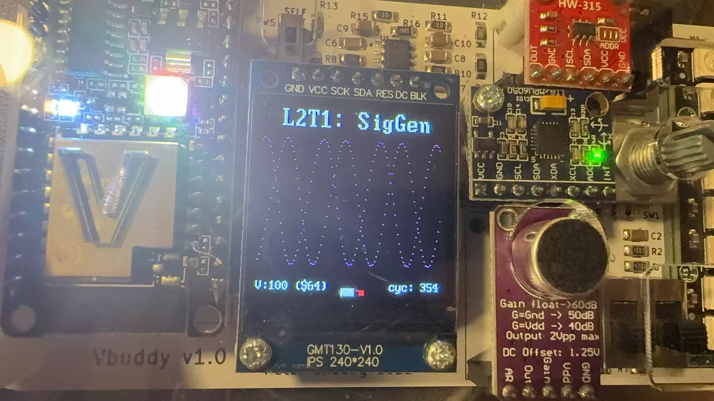

# Task 2 — Dual-Wave Generation Using a Dual-Port ROM

## Contents

- [Overview](#overview)
- [Design Structure](#design-structure)
- [Dual-Port ROM](#dual-port-rom)
- [Address Generation](#address-generation)
- [Phase Offset](#phase-offset)
- [Top-Level Module](#top-level-module)
- [C++ Testbench](#c-testbench)
- [Building and Running](#building-and-running)
- [Results](#results)
- [Observations](#observations)
- [Conclusion](#conclusion)

---

## Overview

Task 2 extended the ROM-based waveform generator developed in Task 1.

Instead of reading one sample from the ROM during each clock cycle, the new design uses a dual-port ROM to read two samples simultaneously. Both outputs use the same waveform lookup table, but the second address is displaced from the first by a configurable offset.

The Vbuddy rotary encoder controls this offset. As the offset changes, the phase difference between the two displayed waveforms also changes.

When the offset is 64 and the ROM contains 256 samples, the two signals have a phase difference of \(90^\circ\). These are known as quadrature signals and are commonly used in communication systems.

The original instructions are available in the [official Lab 2 repository](https://github.com/ELEC50010-IAC/Lab2-SigGen).

---

## Design Structure

The complete design consists of:

- one address counter;
- one offset adder;
- one 256 × 8-bit dual-port ROM; and
- two output signals.

```text
                          offset
                             │
                             ▼
                      ┌─────────────┐
                      │ address1 +  │
                      │   offset    │
                      └──────┬──────┘
                             │ address2
                             │
     ┌───────────┐           ▼
clk ─►           │      ┌───────────────┐
rst ─►  Counter  ├─────►│ addr1         │
en  ─►           │      │               │
     └───────────┘      │ Dual-port ROM │
        address1        │               │
                        │ addr2         │
                        └───────┬───┬───┘
                                │   │
                            data1   data2
                                │   │
                                ▼   ▼
                           Vbuddy plots
```

The two outputs have the same waveform shape and frequency because they are read from the same lookup table.

Their phase difference is determined only by the difference between `address1` and `address2`.

The main files used in this task are:

- [`counter.sv`](counter.sv) — generates the first ROM address;
- [`rom.sv`](rom.sv) — implements the dual-port waveform ROM;
- [`sinegen.sv`](sinegen.sv) — generates both ROM addresses and connects the modules;
- [`sinerom.mem`](sinerom.mem) — contains the waveform samples;
- [`sinegen_tb.cpp`](sinegen_tb.cpp) — controls the simulation and Vbuddy;
- [`doit.sh`](doit.sh) — builds and executes the simulation.

---

## Dual-Port ROM

The ROM used in Task 1 had one address input and one data output. Task 2 adds a second independent address and output:

```systemverilog
input  logic [ADDRESS_WIDTH-1:0] addr1,
input  logic [ADDRESS_WIDTH-1:0] addr2,
output logic [DATA_WIDTH-1:0]    data1,
output logic [DATA_WIDTH-1:0]    data2
```

The memory array is still shared by both ports:

```systemverilog
logic [DATA_WIDTH-1:0] rom_array [2**ADDRESS_WIDTH-1:0];
```

With the default parameters, the ROM contains:

\[
2^8=256
\]

locations, with each location storing an 8-bit sample.

The waveform data is loaded using:

```systemverilog
initial begin
    $display("Loading rom.");
    $readmemh("sinerom.mem", rom_array);
end
```

Both outputs are updated on the same rising clock edge:

```systemverilog
always_ff @(posedge clk) begin
    data1 <= rom_array[addr1];
    data2 <= rom_array[addr2];
end
```

This allows two different samples from the same waveform table to be read simultaneously.

The ROM does not contain two separate waveforms. Both ports access the same stored waveform, but at different positions.

---

## Address Generation

The first ROM address is generated by a counter:

```systemverilog
logic [A_WIDTH-1:0] address1;
```

The counter is instantiated using:

```systemverilog
counter #(
    .WIDTH(A_WIDTH)
) addrCounter (
    .clk   (clk),
    .rst   (rst),
    .en    (en),
    .incr  ({{A_WIDTH-3{1'b0}}, {3{1'b1}}}),
    .count (address1)
);
```

The expression:

```systemverilog
{{A_WIDTH-3{1'b0}}, {3{1'b1}}}
```

produces an `A_WIDTH`-bit value whose three least significant bits are one.

For the default address width of 8 bits:

```text
00000111₂ = 7₁₀
```

Therefore, the first ROM address increases by seven during each enabled clock cycle:

```text
0, 7, 14, 21, 28, ...
```

Because 7 and 256 have no common factor other than 1, the counter eventually visits every ROM address before the sequence repeats.

Using an increment of seven also makes the waveform complete more cycles over the same Vbuddy display interval than an increment of one.

---

## Phase Offset

The second address is generated by adding `offset` to the first address:

```systemverilog
assign address2 = address1 + offset;
```

Therefore:

```text
address2 = address1 + offset
```

For example:

```text
address1 = 20
offset   = 64
address2 = 84
```

Both addresses continue to move by the same counter increment, so both output signals have the same frequency.

The constant address separation creates a constant phase difference.

### Converting offset to phase

The ROM contains 256 samples representing one complete \(360^\circ\) waveform cycle. The phase difference is therefore:

\[
\phi=\frac{\text{offset}}{256}\times360^\circ
\]

Some example offsets are:

| Offset | Fraction of a cycle | Phase difference |
|---:|---:|---:|
| 0 | \(0/256\) | \(0^\circ\) |
| 32 | \(32/256\) | \(45^\circ\) |
| 64 | \(64/256\) | \(90^\circ\) |
| 128 | \(128/256\) | \(180^\circ\) |
| 192 | \(192/256\) | \(270^\circ\), equivalent to \(-90^\circ\) |

When:

```text
offset = 0
```

both ROM ports read the same address, so the two output waveforms overlap.

When:

```text
offset = 64
```

the outputs are separated by one quarter of the waveform table:

\[
\frac{64}{256}=\frac{1}{4}
\]

Therefore, the phase difference is:

\[
\frac{1}{4}\times360^\circ=90^\circ
\]

### Address wraparound

Because the ROM addresses are 8 bits wide, addition automatically wraps around after 255.

For example:

```text
address1 = 250
offset   = 64
```

The mathematical result is:

```text
250 + 64 = 314
```

The 8-bit hardware retains the result modulo 256:

```text
314 mod 256 = 58
```

Therefore:

```text
address2 = 58
```

This wraparound preserves the periodic nature of the waveform.

---

## Top-Level Module

The top-level `sinegen` interface is:

```systemverilog
module sinegen #(
    parameter A_WIDTH = 8,
              D_WIDTH = 8
)(
    input  logic               clk,
    input  logic               rst,
    input  logic               en,
    input  logic [A_WIDTH-1:0] offset,
    output logic [D_WIDTH-1:0] data1,
    output logic [D_WIDTH-1:0] data2
);
```

Two internal address signals are declared:

```systemverilog
logic [A_WIDTH-1:0] address1;
logic [A_WIDTH-1:0] address2;
```

The counter generates `address1`, while the combinational addition generates `address2`:

```systemverilog
assign address2 = address1 + offset;
```

The two addresses are then connected to the dual-port ROM:

```systemverilog
rom #(
    .ADDRESS_WIDTH(A_WIDTH),
    .DATA_WIDTH(D_WIDTH)
) sineRom (
    .clk   (clk),
    .addr1 (address1),
    .addr2 (address2),
    .data1 (data1),
    .data2 (data2)
);
```

The complete data flow is:

```text
Counter → address1 ──────────────► ROM port 1 → data1
               │
               └── + offset ─────► ROM port 2 → data2
```

---

## C++ Testbench

The C++ testbench uses the Verilator-generated `Vsinegen` model:

```cpp
#include "Vsinegen.h"
```

The model is instantiated using:

```cpp
Vsinegen* top = new Vsinegen;
```

### Initial input values

The simulation inputs are initialised using:

```cpp
top->clk = 1;
top->rst = 0;
top->en = 1;
top->offset = 0;
```

The counter is continuously enabled, and the initial phase difference is zero.

### Rotary-encoder input

During each simulation cycle, the phase offset is read from the Vbuddy rotary encoder:

```cpp
top->offset = vbdValue();
```

Turning the encoder changes the second ROM address without changing the first address.

This allows the phase relationship between the waveforms to be adjusted while the simulation is running.

### Plotting two signals

Both ROM outputs are sent to Vbuddy:

```cpp
vbdPlot(int(top->data1), 0, 255);
vbdPlot(int(top->data2), 0, 255);
vbdCycle(simcyc);
```

Calling `vbdPlot()` twice during the same simulation cycle causes Vbuddy to display both signals together.

The plotting range is:

```text
0 to 255
```

which matches the 8-bit unsigned ROM output.

### Ending the simulation

The simulation can be stopped by pressing `q`:

```cpp
if (Verilated::gotFinish() || vbdGetkey() == 'q')
    exit(0);
```

---

## Building and Running

The Verilator command specifies `sinegen` as the top-level module and includes the counter and ROM components:

```bash
verilator -Wall --cc --trace \
    --top-module sinegen \
    sinegen.sv counter.sv rom.sv \
    --exe sinegen_tb.cpp
```

The generated model is compiled using:

```bash
make -j -C obj_dir -f Vsinegen.mk Vsinegen
```

The simulation is executed using:

```bash
./obj_dir/Vsinegen
```

These commands are included in `doit.sh`.

The script can be run using:

```bash
chmod +x doit.sh
./doit.sh
```

It should not be run with `source ./doit.sh`, because the script contains `set -e`. If a build command fails while the script is sourced, the current terminal shell may also terminate.

---

## Results

The following result shows the two signals displayed simultaneously on Vbuddy:



The waveforms have:

- the same amplitude;
- the same frequency;
- the same general shape; and
- a phase difference determined by `offset`.

At an offset of approximately 64, the waveforms are separated by one quarter of a period, corresponding to a \(90^\circ\) phase difference.

The result confirms that:

- both ROM ports access the waveform table correctly;
- two samples can be read during the same clock cycle;
- the counter produces a continuous address sequence;
- address wraparound occurs correctly;
- the rotary encoder changes the second address;
- both signals maintain the same frequency; and
- the phase difference changes without modifying the stored waveform.

---

## Observations

Task 1 changed the waveform frequency by changing the address increment. Task 2 keeps the same address increment for both outputs and changes only the address separation.

The two controls therefore have different purposes:

| Value | Effect |
|---|---|
| Counter increment | Controls waveform frequency |
| Address offset | Controls phase difference |

The waveform generator can be understood as a phase accumulator:

```text
address1 = current phase
address2 = current phase + phase offset
```

The shared ROM then converts each phase address into a waveform amplitude.

With an offset of 64, the second address is always one quarter of a waveform cycle ahead of the first. Because the lookup table was generated using a cosine function, the second output represents a \(90^\circ\) phase-advanced version of the first output.

At large counter increments, fewer adjacent ROM samples are displayed during each waveform period. The output can therefore appear less smooth even though the two signals retain the correct relative phase.

---

## Conclusion

Task 2 successfully extended the original waveform generator to produce two signals simultaneously using a dual-port ROM.

A single counter generated the first ROM address, while the second address was calculated by adding a configurable offset. Both ports read from the same waveform lookup table, ensuring that the outputs had the same frequency and amplitude.

The Vbuddy rotary encoder controlled the offset and therefore allowed the phase difference to be adjusted interactively. An offset of 64 produced a \(90^\circ\) phase separation for the 256-sample waveform table.

This task demonstrated:

- dual-port ROM implementation;
- simultaneous access to two ROM locations;
- phase-offset generation using address arithmetic;
- automatic address wraparound;
- quadrature waveform generation;
- parameterised hierarchical SystemVerilog design; and
- simultaneous plotting of two signals using Vbuddy.