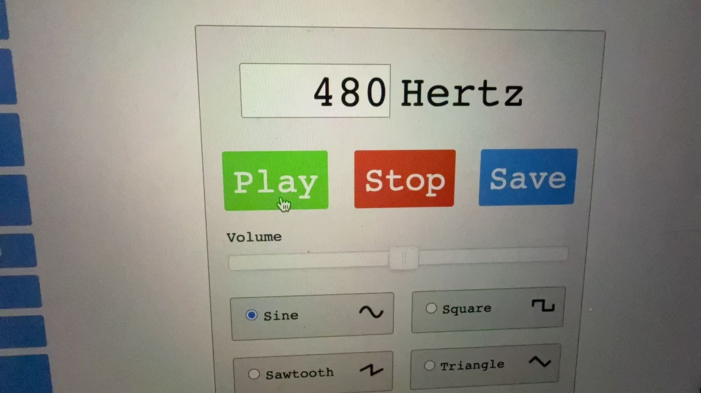
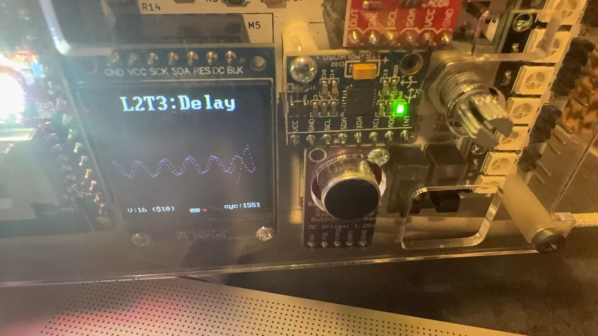

# Task 3 — Audio Capture and Delay Using RAM

## Contents

- [Overview](#overview)
- [Design Structure](#design-structure)
- [Dual-Port RAM](#dual-port-ram)
- [Circular Buffer](#circular-buffer)
- [Address Generation](#address-generation)
- [Top-Level Module](#top-level-module)
- [C++ Testbench](#c-testbench)
- [Building and Running](#building-and-running)
- [Test Procedure](#test-procedure)
- [Results](#results)
- [Troubleshooting](#troubleshooting)
- [Observations](#observations)
- [Conclusion](#conclusion)

---

## Overview

Task 3 uses a dual-port RAM to capture, store and retrieve audio samples received from the Vbuddy microphone.

Each new microphone sample is written into the next RAM location. At the same time, the system reads from an earlier RAM address. The retrieved value is therefore an older version of the input sample, producing a controllable signal delay.

The Vbuddy rotary encoder controls the difference between the write and read addresses. Increasing this offset increases the number of samples between the original and delayed signals.

The original instructions are available in the [official Lab 2 repository](https://github.com/ELEC50010-IAC/Lab2-SigGen#task-3---capture-and-display-audio-signal-in-ram).

---

## Design Structure

The system contains:

- a 9-bit address counter;
- a 512 × 8-bit dual-port RAM;
- a subtractor for calculating the read address;
- a Vbuddy microphone input;
- a Vbuddy rotary-encoder input; and
- two Vbuddy waveform plots.

```text
                         offset
                            │
                            ▼
                     ┌─────────────┐
                     │ wr_addr -   │
                     │   offset    │
                     └──────┬──────┘
                            │ rd_addr
                            │
        ┌─────────┐         ▼
clk ───►│         │    ┌────────────────┐
rst ───►│ Counter ├───►│ wr_addr        │
wr  ───►│         │    │                │
        └─────────┘    │ Dual-port RAM  │
          wr_addr      │                │
                       │ rd_addr        │
mic_signal ───────────►│ wr_data        │
                       └───────┬────────┘
                               │
                               │ delayed_signal
                               ▼
                         Vbuddy display
```

The main files are:

- [`counter.sv`](counter.sv) — generates consecutive write addresses;
- [`ram.sv`](ram.sv) — implements the dual-port RAM;
- [`sigdelay.sv`](sigdelay.sv) — connects the counter and RAM;
- [`sigdelay_tb.cpp`](sigdelay_tb.cpp) — communicates with Vbuddy;
- [`doit.sh`](doit.sh) — builds and runs the simulation.

The files `sinegen.py` and `sinerom.mem` are inherited from the previous tasks and are not used by the Task 3 build.

---

## Dual-Port RAM

The RAM is parameterised by its address and data widths:

```systemverilog
module ram #(
    parameter ADDRESS_WIDTH = 9,
    parameter DATA_WIDTH = 8
)(
    input  logic                     clk,
    input  logic                     wr,
    input  logic                     rd,
    input  logic [ADDRESS_WIDTH-1:0] wr_addr,
    input  logic [ADDRESS_WIDTH-1:0] rd_addr,
    input  logic [DATA_WIDTH-1:0]    wr_data,
    output logic [DATA_WIDTH-1:0]    rd_data
);
```

The default address width is 9 bits, so the number of RAM locations is:

\[
2^9=512
\]

Each memory location stores one 8-bit sample. The complete memory is therefore:

```text
512 × 8-bit
```

The memory array is declared using:

```systemverilog
logic [DATA_WIDTH-1:0] ram_array [2**ADDRESS_WIDTH-1:0];
```

With the default parameters, this is equivalent to:

```systemverilog
logic [7:0] ram_array [511:0];
```

### Read and write operations

The RAM supports a separate write address and read address:

```systemverilog
always_ff @(posedge clk) begin
    if (wr)
        ram_array[wr_addr] <= wr_data;

    if (rd)
        rd_data <= ram_array[rd_addr];
end
```

When `wr` is asserted:

```text
ram_array[wr_addr] ← wr_data
```

When `rd` is asserted:

```text
rd_data ← ram_array[rd_addr]
```

Because the two operations use separate addresses, a new microphone sample can be stored while an older sample is retrieved during the same clock cycle.

---

## Circular Buffer

The RAM operates as a circular audio buffer.

The write address moves through:

```text
0, 1, 2, ..., 510, 511, 0, 1, ...
```

Because the address is 9 bits wide, incrementing beyond 511 automatically returns it to zero.

New samples eventually overwrite the oldest samples:

```text
┌──────────────────────────────────────────┐
│ 0 │ 1 │ 2 │ 3 │ ... │ 509 │ 510 │ 511 │
└──────────────────────────────────────────┘
  ▲                                       │
  └────────── address wraps around ───────┘
```

This allows continuous audio capture without moving all stored samples on every clock cycle.

---

## Address Generation

The write address is generated by the counter:

```systemverilog
counter #(
    .WIDTH(A_WIDTH)
) addrCounter (
    .clk   (clk),
    .rst   (rst),
    .en    (wr),
    .incr  (9'd1),
    .count (wr_addr)
);
```

The counter increments once whenever writing is enabled:

```text
wr_addr = wr_addr + 1
```

The read address is calculated using:

```systemverilog
assign rd_addr = wr_addr - offset;
```

For example:

```text
wr_addr = 200
offset  = 16
rd_addr = 184
```

The output is therefore the sample written 16 sample periods earlier.

### Address wraparound

If the current write address is smaller than the offset, the subtraction wraps around the 9-bit address range.

For example:

```text
wr_addr = 10
offset  = 16
```

The mathematical result is:

```text
10 - 16 = -6
```

In a 512-location circular buffer:

```text
-6 mod 512 = 506
```

Therefore:

```text
rd_addr = 506
```

This is the correct location 16 samples behind address 10.

### Delay in time

The address offset specifies the delay in samples:

\[
N_{\text{delay}}=\text{offset}
\]

If the sample rate is \(f_s\), the corresponding time delay is:

\[
T_{\text{delay}}=\frac{\text{offset}}{f_s}
\]

Increasing `offset` therefore increases the time delay.

---

## Top-Level Module

The top-level `sigdelay` module connects the address counter to the RAM:

```systemverilog
module sigdelay #(
    parameter A_WIDTH = 9,
    parameter D_WIDTH = 8
)(
    input  logic               clk,
    input  logic               rst,
    input  logic               wr,
    input  logic               rd,
    input  logic [A_WIDTH-1:0] offset,
    input  logic [D_WIDTH-1:0] mic_signal,
    output logic [D_WIDTH-1:0] delayed_signal
);
```

The internal addresses are declared using:

```systemverilog
logic [A_WIDTH-1:0] wr_addr;
logic [A_WIDTH-1:0] rd_addr;
```

The RAM is instantiated using:

```systemverilog
ram #(
    .ADDRESS_WIDTH(A_WIDTH),
    .DATA_WIDTH(D_WIDTH)
) audioRam (
    .clk     (clk),
    .wr      (wr),
    .rd      (rd),
    .wr_addr (wr_addr),
    .rd_addr (rd_addr),
    .wr_data (mic_signal),
    .rd_data (delayed_signal)
);
```

The complete data path is:

```text
Vbuddy microphone
       │
       │ mic_signal
       ▼
RAM write port
       │
       │ stored for offset samples
       ▼
RAM read port
       │
       │ delayed_signal
       ▼
Vbuddy plot
```

---

## C++ Testbench

The testbench uses the Verilator-generated model:

```cpp
#include "Vsigdelay.h"
```

The top-level design is instantiated using:

```cpp
Vsigdelay* top = new Vsigdelay;
```

### Initial values

The simulation inputs are initialised using:

```cpp
top->clk = 1;
top->rst = 0;
top->wr = 1;
top->rd = 1;
top->offset = 64;
```

Both RAM operations are continuously enabled:

```text
wr = 1 → store the current microphone sample
rd = 1 → retrieve a delayed sample
```

### Microphone buffer

The microphone buffer is initialised using:

```cpp
vbdInitMicIn(RAM_SZ);
```

The buffer size is determined from:

```cpp
#define ADDRESS_WIDTH 9
#define RAM_SZ pow(2, ADDRESS_WIDTH)
```

Therefore:

\[
RAM\_SZ=2^9=512
\]

During each simulation cycle, the next microphone sample is obtained using:

```cpp
top->mic_signal = vbdMicValue();
```

When the current Vbuddy microphone buffer has been read, Vbuddy captures another block of samples.

### Delay control

The rotary encoder controls the delay:

```cpp
top->offset = abs(vbdValue());
```

The displayed encoder value corresponds to the RAM address offset in samples.

For example, the result photograph shows:

```text
V: 16 ($10)
```

This represents:

```text
16 decimal = 0x10
```

so the delayed output is read approximately 16 RAM locations behind the current write address.

### Waveform display

Both signals are sent to Vbuddy:

```cpp
vbdPlot(int(top->mic_signal), 0, 255);
vbdPlot(int(top->delayed_signal), 0, 255);
vbdCycle(simcyc);
```

The two plotted channels represent:

1. the current microphone input;
2. the delayed sample retrieved from RAM.

The simulation can be stopped by pressing `q`:

```cpp
if ((Verilated::gotFinish()) || (vbdGetkey() == 'q'))
    exit(0);
```

---

## Building and Running

The Verilator command specifies `sigdelay` as the top-level module:

```bash
verilator -Wall --cc --trace \
    --top-module sigdelay \
    sigdelay.sv counter.sv ram.sv \
    --exe sigdelay_tb.cpp
```

The generated simulation is compiled using:

```bash
make -j -C obj_dir -f Vsigdelay.mk Vsigdelay
```

It is then executed using:

```bash
./obj_dir/Vsigdelay
```

These commands are included in `doit.sh`.

The complete script can be run using:

```bash
chmod +x doit.sh
./doit.sh
```

The script should not be run with:

```bash
source ./doit.sh
```

because it contains `set -e`. Sourcing the script would allow a build error to terminate the current interactive shell.

---

## Test Procedure

A stable audio tone was used so that the original and delayed signals could be compared clearly.

The selected test signal was a 480 Hz sine wave:



The test procedure was:

1. Connect Vbuddy and its microphone/amplifier module.
2. Start the 480 Hz sine-wave source.
3. Position the sound source close to the microphone.
4. Run the simulation using `./doit.sh`.
5. Allow the RAM buffer to fill with valid samples.
6. Observe the two plotted signals on Vbuddy.
7. Turn the rotary encoder to change the address offset.
8. Compare the original and delayed waveforms.
9. Press `q` to end the simulation.

Using a stable sine wave made the time displacement easier to identify than using speech or irregular background noise.

---

## Results

The resulting Vbuddy display is shown below:



The display shows two periodic traces corresponding to:

- the current 480 Hz microphone signal;
- the delayed signal read from RAM.

The Vbuddy parameter display shows:

```text
V: 16 ($10)
```

Therefore, the selected address offset was 16 samples.

The two signals have the same approximate:

- waveform shape;
- amplitude;
- frequency; and
- average level.

However, they are displaced relative to each other because one signal is read from an earlier RAM address.

The experiment confirms that:

- the microphone signal was captured successfully;
- the input samples were written into RAM;
- stored samples were retrieved through the read port;
- the RAM operated as a circular buffer;
- two signals could be plotted simultaneously;
- the rotary encoder controlled the delay offset; and
- the output retained the periodic form of the original signal.

---

## Troubleshooting

### Serial-port error

The first attempt to start Vbuddy produced:

```text
Error opening port: /dev/tty.usbserial-1422
```

The actual serial device was:

```text
/dev/tty.usbserial-14220
```

The final character was removed because `vbuddy.cfg` did not contain a newline at the end of the file.

The configuration was corrected to contain:

```text
/dev/tty.usbserial-14220
```

followed by a final newline.

After this correction, the Vbuddy connection opened successfully.

### Terminal closed after an error

The build script was initially executed using:

```bash
source ./doit.sh
```

Because `doit.sh` contains:

```bash
set -e
```

a failed command caused the current shell to terminate.

The correct method is:

```bash
./doit.sh
```

This runs the script in a separate process and returns control to the existing terminal when the program finishes.

### Selecting a suitable input signal

Touching the microphone did not initially produce an easily recognisable result. A continuous 480 Hz sine wave provided a clearer and repeatable test signal.

This made it easier to distinguish the delayed output from the original microphone input.

---

## Observations

Task 3 differs from the earlier ROM tasks because its memory contents are created during operation.

In Tasks 1 and 2, the waveform samples were calculated in advance and stored in ROM. In Task 3, live microphone values are continuously written into RAM.

The delay is created through address selection rather than by physically shifting all stored samples:

```text
delay = write address - read address
```

This is an efficient implementation because changing the delay only requires changing `offset`.

The experiment also demonstrates the distinction between two independent properties:

| Property | Controlled by |
|---|---|
| Position of the newest sample | Write-address counter |
| Number of delayed samples | Address offset |
| Delay in seconds | Offset and sample rate |
| Stored signal values | Vbuddy microphone input |

The maximum useful delay is limited by the RAM capacity. With 512 locations, the circular buffer can store up to 512 recent samples before older data is overwritten.

At the beginning of the simulation, some RAM locations may not yet contain valid microphone samples. The delayed waveform becomes reliable after enough samples have been written into the buffer.

---

## Conclusion

Task 3 successfully implemented a variable signal-delay system using a 512 × 8-bit dual-port RAM.

A 9-bit counter generated consecutive RAM write addresses. Microphone samples received from Vbuddy were written into the RAM, while an earlier sample was selected using:

```systemverilog
assign rd_addr = wr_addr - offset;
```

This address relationship formed a circular audio buffer. The Vbuddy rotary encoder controlled the offset and therefore changed the delay between the original and retrieved signals.

A 480 Hz sine wave was used as a stable test input. Vbuddy displayed both the captured microphone signal and the delayed RAM output, confirming that the complete data path operated successfully.

This task demonstrated:

- parameterised RAM implementation;
- simultaneous read and write operations;
- circular-buffer addressing;
- live microphone sample capture;
- delay generation using an address offset;
- interactive control using the Vbuddy rotary encoder;
- simultaneous plotting of original and delayed signals; and
- debugging of serial-port and execution issues.